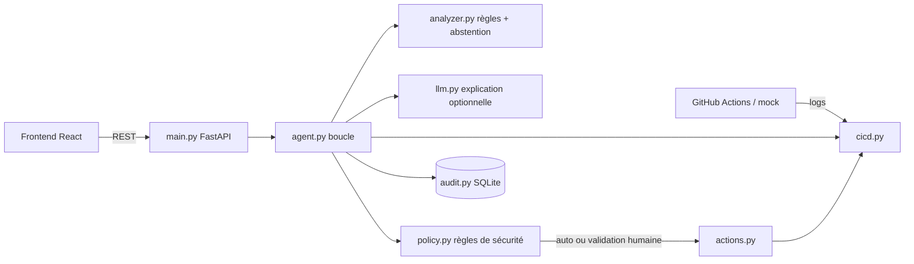

# Architecture

**Boucle de l'agent** : `fetch_logs` -> `analyze_logs` -> `explain_with_llm` (optionnel) -> `policy` -> action
automatique ou `awaiting_approval`. Chaque étape est écrite dans la trace de l'incident et dans le journal d'audit.

| Action | Risque | Règle |
| --- | --- | --- |
| `rerun_job` | faible | auto si confiance >= seuil et relances < `MAX_RETRIES` |
| `open_pr` | moyen | auto (la PR est relue par un humain, jamais fusionnée par l'agent) |
| `rollback` | élevé | validation humaine toujours obligatoire |
| secrets / authentification | - | l'agent n'agit jamais, il escalade |

`DRY_RUN=true` (défaut) : toute action est simulée.
